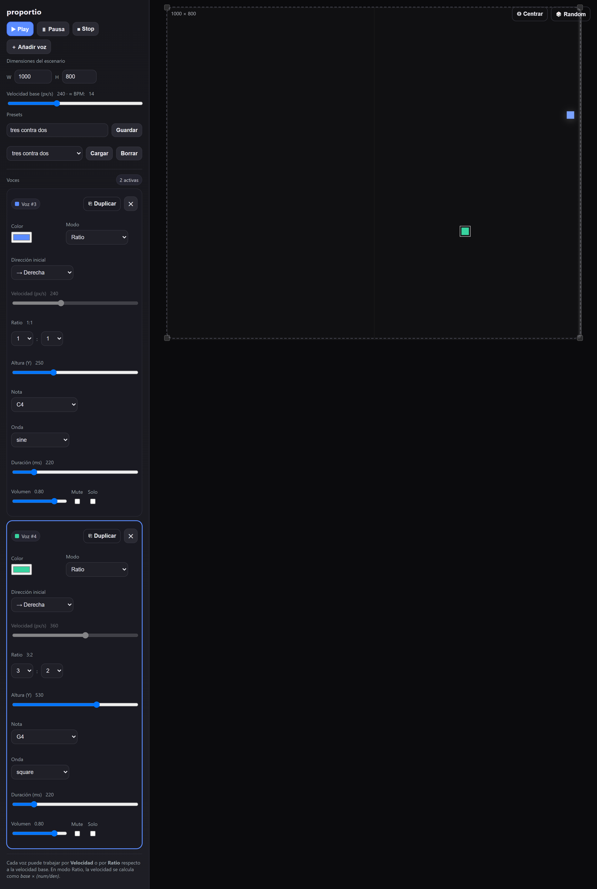

# proportio

Squares bounce horizontally inside a resizable frame. Every impact against a wall plays a note.

**[Open it](https://memoriainfinita.github.io/proportio/)** and press Play. **[Guide](docs/guide/README.md)**: how to play it.

Each voice can run at its own speed, or lock its speed to a ratio of a base speed. A voice at 3:2 crosses the frame three times for every two crossings of a 1:1 voice, and keeps doing so indefinitely: the frame is fixed and the bounce is perfect, so the period never drifts.

One self-contained HTML file: no server, no build step, no dependencies. It also runs from disk: open `index.html` in a browser.

In Renaissance mensural notation a *proportio* was a sign that made one voice move at a fixed ratio against the tactus, the underlying beat — `dupla` for 2:1, `sesquialtera` for 3:2 — and different voices could carry different ones at the same time. That is exactly this: a base speed, and every voice locked to a ratio of it.

Boethius drew the finer line. *Proportio* compares two terms; a collection of ratios, three terms or more, is *proportionalitas*. Add a third voice and the name stops being quite right — which is as good a definition of polyrhythm as any.

Sound is synthesised with the Web Audio API — one oscillator per hit, no samples — and every voice goes through a master gain and a global limiter, so dense patches do not clip. Audio does not start until you press Play, because browsers require a user gesture first.

Hits are not quantised to the frame. The simulation works out the exact fraction of the frame at which each collision happened and schedules the note at that instant, so two voices landing in the same frame keep their real separation instead of firing together. The cost is up to one frame of latency.

## Per voice

| Control | Range |
| --- | --- |
| Mode | Speed or Ratio |
| Speed | 20–600 px/s, in Speed mode |
| Ratio | `num:den`, each from 1–10 or 12. Speed becomes `base × (num/den)` |
| Initial direction | left or right |
| Height (Y) | anywhere within the frame |
| Note | a fixed list of 22, C3 to C6 |
| Wave | sine, triangle, square, sawtooth |
| Duration | 40–1200 ms |
| Volume, Mute, Solo, Colour | |

With any voice in solo, only the soloed voices sound. Mute always wins.

Voices can be duplicated or deleted. A duplicate keeps every parameter and drops 26 px below the original.

In Speed mode the app still shows a ratio: it searches the available numerators and denominators for the pair closest to `speed / base`. It is a readout, not a constraint — the voice stays free.

## Global

- **Base speed**, 40–600 px/s, with an approximate BPM alongside it: `60 × base / width`, the impacts per minute of a 1:1 voice crossing the frame
- **Stage size**, 200–1400 by 120–800, from the W and H fields or by dragging any of the four corner handles. Resizing changes every period at once, since the period depends on the width
- **Play**, **Pause**, **Stop** (pauses and recentres)
- **Centre**, which returns every voice to the middle without stopping
- **Random**, which rerolls height, direction and colour on every voice, and speed only on those in Speed mode

It opens with two voices: one in Speed mode, and one at 3:2 heading left, square wave, E4.

## Presets

Save, load and delete named presets. A preset keeps the stage size, the base speed and every voice, but not where the squares are: loading one stops playback and recentres. Presets live in the browser's `localStorage` and never leave it.

Nothing else is saved. Reloading the page brings back the two starting voices.

## Keyboard

| Key | Action |
| --- | --- |
| Space | Play / Pause |
| N | Add a voice |
| Delete, Backspace | Delete the selected voice |
| S | Solo the selected voice |
| M | Mute the selected voice |

Select a voice by clicking its square or any control on its card. Shortcuts are ignored while typing in a field.

## Related

PULSUS is the sibling project: balls bouncing inside a rotating polygon, where the edge decides the note.

The two are opposites on purpose. In PULSUS the pattern emerges from physics — gravity, friction against spinning walls, a moving figure — and no period is ever exact. Here there is no physics at all: the geometry is fixed, the bounce is lossless, and the ratios are set by hand. One explores what a system produces; the other explores what an arithmetic sounds like.

## License

GNU General Public License v3.0 or later. See [LICENSE](LICENSE).

## Credits

Developed by [@memoriainfinita](https://github.com/memoriainfinita) with the assistance of Claude (Anthropic).
