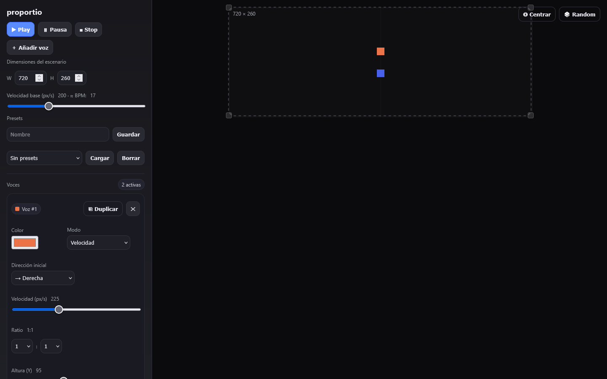
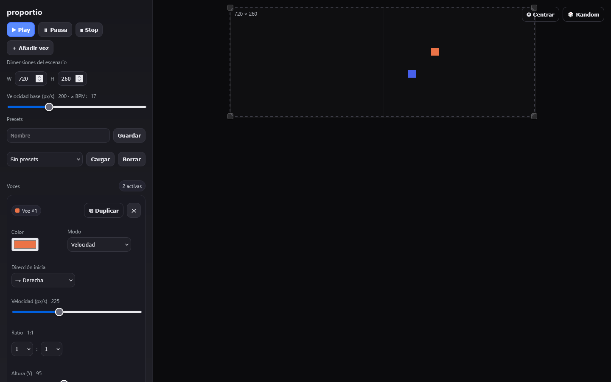
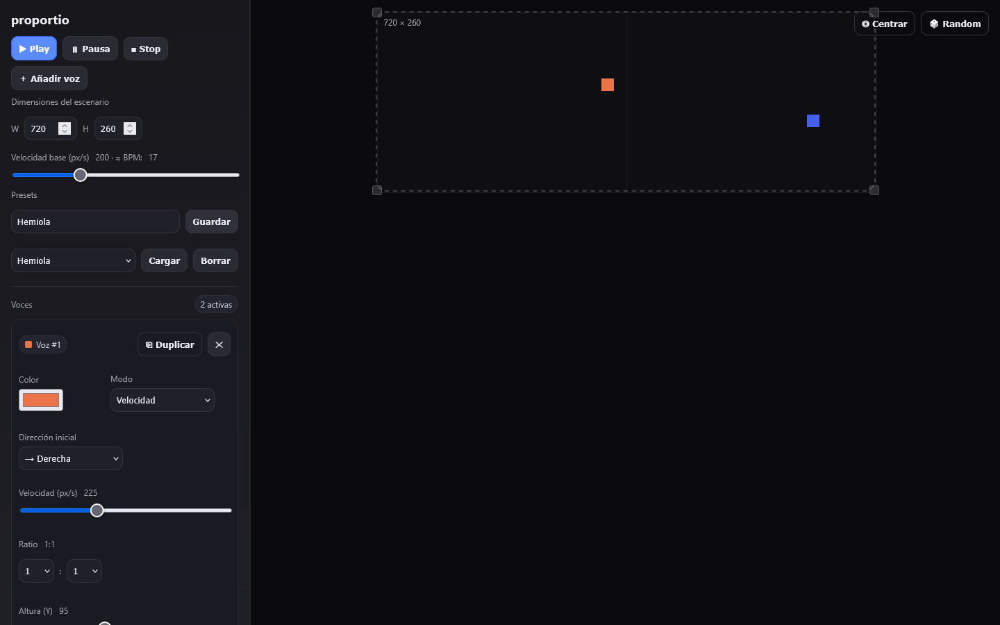

# proportio guide

How to play proportio. The [README](../../README.md) has the full tables of controls and the ideas behind the instrument; this page is a short walk through. The interface is in Spanish, so the labels below are the ones on screen.

Open https://memoriainfinita.github.io/proportio/, or open `index.html` from disk: it needs no server. Nothing is uploaded; sound is synthesised in the browser.

## Make it sound

Press **Play**. Squares bounce horizontally inside the frame, and each time one hits a wall it plays a note. It opens with two voices: one in **Velocidad** mode, and one locked to 3:2.

- **Pausa** pauses; **Stop** pauses and recentres the squares; **Centrar** returns every voice to the middle without stopping; **Random** rerolls the height, direction and colour of every voice, and the speed only of those in Velocidad mode
- The space bar plays and pauses

## Voices

Each voice has a card in **Voces**. Click a square, or any control on its card, to select it.

- **Modo**: **Velocidad** gives the voice its own speed; **Ratio** locks it to a ratio of the base speed. A voice at 3:2 crosses the frame three times for every two crossings of a voice at 1:1, and keeps doing so for as long as it runs
- **Dirección inicial**, **Altura (Y)** and **Color**
- **Nota**: C3 to C6; **Onda**: sine, triangle, square or sawtooth; duration and volume
- **Duplicar** copies a voice, and ✕ removes it; **＋ Añadir voz** adds one (`N`)
- Mute (`M`) silences the selected voice, and solo (`S`) leaves only the soloed voices sounding; mute always wins

## The frame and the base speed

- **Dimensiones del escenario**: type the width and height, or drag any corner of the frame. Every period changes with it
- **Velocidad base**: the speed that a 1:1 voice has, with the approximate BPM next to it

## Keep a setup

Write a name under **Presets** and press **Guardar**. **Cargar** and **Borrar** work on the one chosen in the list. A preset keeps the frame size, the base speed and every voice, but not where the squares are.

Nothing else is saved: reloading the page brings back the two starting voices.
